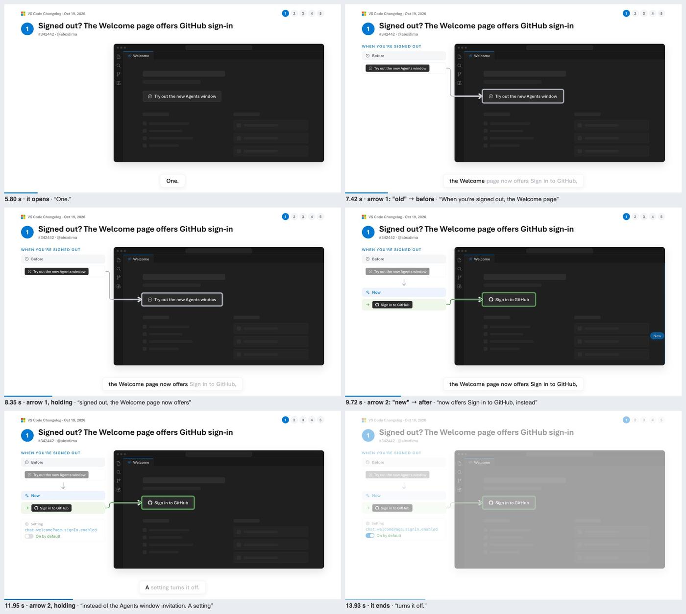
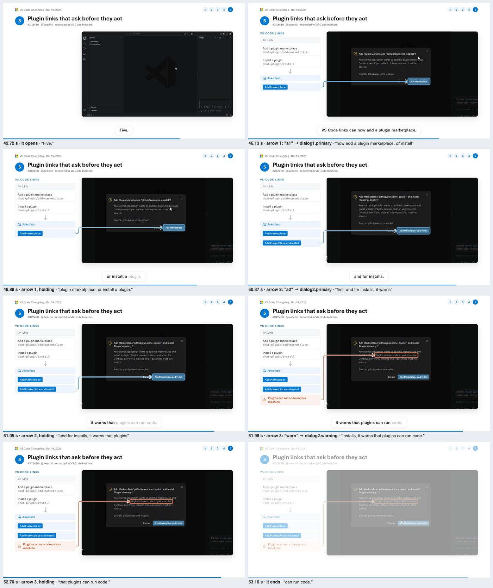

# The Oct 19 video: the standard

The changelog of Oct 19, 2026: 58 s, three chapters recorded in VS Code Insiders (two in the Agents window, signed in), two drawn. Its files are here: [storyboard.json](storyboard.json) (the narration), [digest.json](digest.json) (the chapters) and [demos/](demos/) (the recordings). [review/](review/) has two of its review sheets (`prs digest review` makes them): a drawn chapter and one recorded in the main window. The Agents-window chapters aren't there because their frames show the account; in c5's first frame, the account picture is hidden.

| | Pick | Shown as | Why | Arrows |
|-|------|----------|-----|--------|
| c1 | #342442 Welcome page: Sign in to GitHub when signed out | drawn: `button-swap` | the button shows only to a signed-out user on a fresh profile's Welcome page; the recording machine is signed in | grey from Before to the old button, then green from Now to the new one |
| c2 | #342404 New Nested Session first on session rows | recorded: Agents window | it is a button of a session row: hover it, click it | to the tooltip ("New Nested Session"), then to the nested session the click adds |
| c3 | #342455 Agents window badge on by default in Stable | drawn: `app-badge` | the badge is on the app icon in the dock, outside the window | to the badge |
| c4 | #341230 /fork takes a title or a prompt | recorded: Agents window | type `/fork` in a session: the menu lists both forms; fork with a title | to `/fork prompt <prompt>`, to `/fork <title>`, to the forked session |
| c5 | #342430 plugin links ask first | recorded: main window | open the two `vscode-insiders://` links: each opens its dialog (cancelled) | blue to each dialog's button, then orange to the warning sentence |

## What makes it work

- **Recorded wherever it can be.** c2, c4 and c5 are VS Code itself. c1 and c3 are drawn only because a recording can't show them here, and the drawings use the PR's own strings.
- **Every arrow is said.** The narration names, in order, each thing an arrow points at ("a session's first button is now New Nested Session … One click starts a new chat inside it"), and each arrow starts when its words are spoken (`at`), from the strip row that says the same thing.
- **The recordings keep the narration's pace.** Each step of a demo waits for its words (`cue`): the hover at "first button", the click just after "One click", `/fork` typed at "slash fork". The menu stays up a second after "or a title" (`{ offset: 1.3 }`) so its arrow has time, then the title is typed and the fork appears.
- **Sessions are made before the recording.** `setup()` opens the Agents window and sends one short, harmless prompt; the recording starts on that session, not on a loading screen.
- **Rings are tight.** c5's warning is a sentence of the dialog: its mark is `{ text, tight: true }`, so the ring hugs the sentence, not the dialog. c4's camera is in close on the menu, then pulls back to show the new session.
- **The strip says what the recording shows.** c2's Now rows are "New Nested Session ⌘T" and "One click starts a new chat": both on screen.
