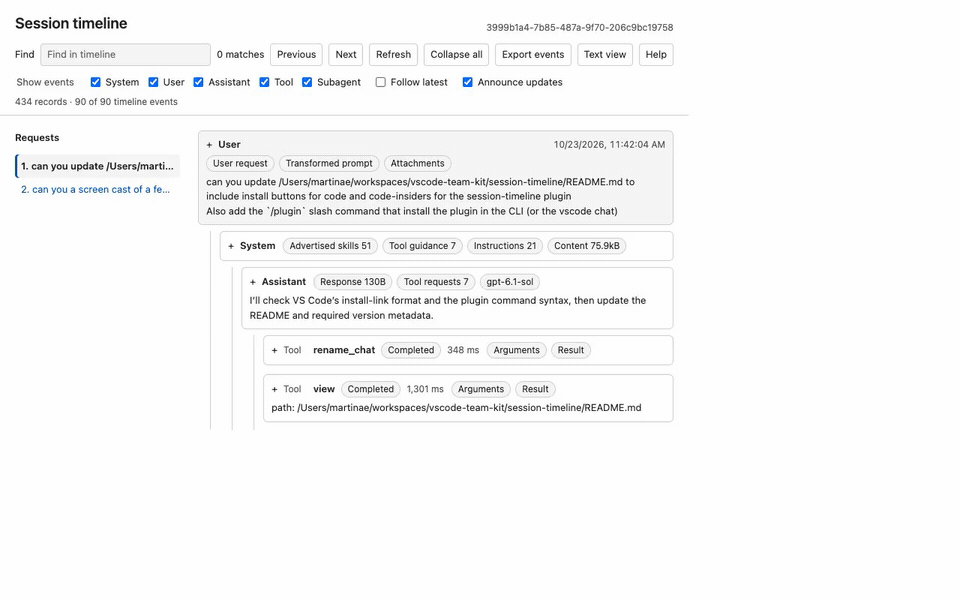

# Session timeline

Inspect the current Copilot session as a live, searchable timeline canvas.



> **Experimental:** Requires a Copilot host supporting SDK canvas extensions. No additional npm dependencies are needed; the host resolves `@github/copilot-sdk/extension`.

## Skills

| Skill | Description |
|---|---|
| [session-timeline](skills/session-timeline/) | Opens the current session's live timeline, with optional search and category filtering |

## Getting started

[](vscode://chat-plugin/install?source=microsoft%2Fvscode-team-kit&plugin=session-timeline)
[](vscode-insiders://chat-plugin/install?source=microsoft%2Fvscode-team-kit&plugin=session-timeline)

The buttons add the `microsoft/vscode-team-kit` marketplace and install `session-timeline` after confirmation. They require a VS Code version with plugin install-link support, plugins enabled, and a Copilot Agent Host session; VS Code can prompt to create a session if needed.

Alternatively, run these slash commands in an interactive Copilot CLI session or a VS Code Copilot chat session that supports `/plugin`:

```text
/plugin marketplace add microsoft/vscode-team-kit
/plugin install session-timeline@vscode-team-kit
```

For local development, use your host's plugin-from-source workflow with the local `session-timeline` directory. In VS Code, run **Chat: Install Plugin from Source** and enter that directory's absolute path.

Once installed, enable the plugin, then ask “show the session timeline” or invoke `/session-timeline`.

## How it works

The extension joins the current session, subscribes before fetching `session.getEvents()`, and merges events by their stable IDs to avoid a history/live-update race. It groups user turns and nests system, assistant, tool, and subagent activity by semantic ownership rather than treating the chronological `parentId` chain as a tree. History is refreshed after truncation or context clearing.

The canvas provides:

- Sticky request navigation with the current request highlighted. All event headers stack flush at the top while scrolling their content and descendants.
- Find across readable details, with raw-record fallback, a persistent "2 of 40" match counter, and wrapping up/down navigation (arrow buttons, ArrowUp/ArrowDown, or Enter/Shift+Enter). Changing the query automatically jumps to a match after the typing delay. Background updates preserve the current selection and counter. Find opens matching details without filtering the tree; category filters still retain context ancestors.
- Find stays pinned above the timeline. Matching runs in a background worker after a 200 ms typing delay; each new keystroke cancels stale work. Live updates defer timeline rebuilding while the Find input has focus.
- Inline section pills on System and Assistant headers, including tool-request counts, model names, and UTF-8 content/response sizes.
- User requests show section pills on the title line alongside the local date and time. Tool headers combine status and duration in one pill, with UTF-8 sizes on Arguments and Result pills. Tool previews use CSS ellipses with full-text tooltips.
- Expandable prompts, reasoning, tool arguments/results/errors, durations, and raw SDK records. Collapsed cards show concise section outlines with direct links to their details; tool summaries prefer readable descriptions and paths over JSON.
- Collapse all expanded events at once, including events hidden by the current filters.
- System-prompt summaries for advertised skills, tool-guidance headings, and instruction headings.
- Live updates, optional follow-latest behavior, manual refresh, and SDK-event JSONL export.
- Native keyboard-operable controls, visible focus indicators, accessibility help (Alt+F1), and a plain-text view (Alt+F2). Announcements can be disabled in the toolbar.

`vscode-session-timeline` exposes `getStatus`, `setFilter`, and `refresh` actions. It takes no open input. Reopening an existing instance reuses its server and current filters/expansion state.

## Data and privacy

All processing is local to the extension. A loopback-only HTTP server serves the canvas with host validation, a same-site HTTP-only session cookie, same-origin mutation checks, and a content security policy. Event content is rendered as text, never executable HTML or agent-authored links. There is no telemetry, model call, token request, or third-party resource loading.

The extension does not read private session paths or write event history to disk. View state is in memory, keyed by canvas instance within the joined session; it survives hiding/reopening the panel but resets when the extension restarts. **Export events** is an explicit browser download. Exported files can contain sensitive prompts, paths, tool output, and reasoning: review before sharing.

The SDK's public durable event history is not a byte-for-byte copy of `events.jsonl`: internal skill/usage records may be filtered or resolved. Streaming deltas are not rendered, and past ephemeral events cannot be recovered. Tool guidance extracted from prompt text is not an authoritative model-visible tool inventory. Optional fields depend on the runtime/provider. The canvas inspects only its joined session; offline imports and arbitrary-session browsing are not included.

## Validation

```sh
node --check session-timeline/extensions/session-timeline/extension.mjs
node --test session-timeline/test/*.test.mjs
```

## Plugin structure

```text
session-timeline/
├── .plugin/plugin.json
├── CHANGELOG.md
├── README.md
├── skills/session-timeline/SKILL.md
├── extensions/session-timeline/
│   ├── extension.mjs
│   ├── model.mjs
│   ├── source.mjs
│   ├── server.mjs
│   └── public/
│       ├── index.html
│       ├── find-worker.mjs
│       ├── timeline.css
│       └── timeline.mjs
└── test/
    ├── find-worker.test.mjs
    ├── model.test.mjs
    ├── source.test.mjs
    └── server.test.mjs
```
